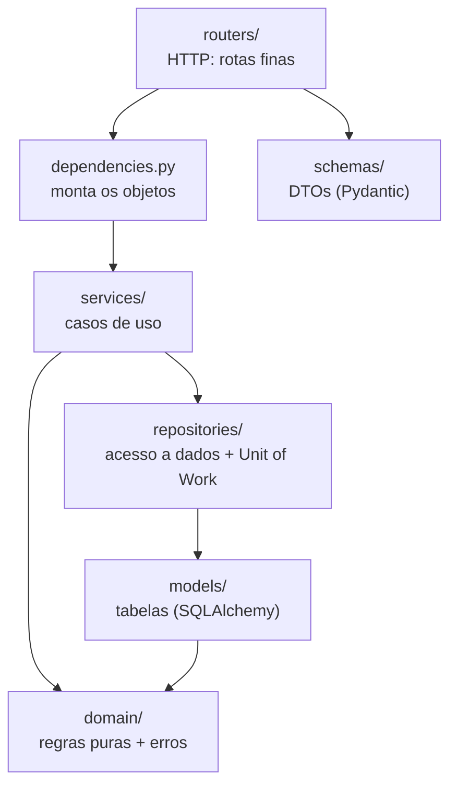

# Arquitetura do Backend

> Como o código do backend é organizado e quais padrões de projeto ele segue. As regras de negócio estão no [escopo do sistema](diagrama.md); este documento trata de **onde** cada coisa fica no código.

## Sumário

1. [Camadas](#1-camadas)
2. [Caminho de uma requisição](#2-caminho-de-uma-requisição)
3. [Padrões em uso](#3-padrões-em-uso)
4. [Padrões planejados](#4-padrões-planejados)
5. [Como adicionar uma feature](#5-como-adicionar-uma-feature)
6. [Decisões](#6-decisões)

---

## 1. Camadas

| Pasta             | Responsabilidade                                                                 | Pode importar                         |
| ----------------- | -------------------------------------------------------------------------------- | ------------------------------------- |
| `domain/`         | Regras de negócio puras e erros de domínio. Sem banco, sem HTTP, sem framework.  | Nada do projeto                       |
| `models/`         | Tabelas mapeadas pelo SQLAlchemy. São as entidades do sistema.                   | `domain/`                             |
| `repositories/`   | Consultas ao banco e o Unit of Work, que controla a transação.                   | `models/`, `domain/`                  |
| `services/`       | Casos de uso: buscam dados, aplicam regras, salvam. Não conhecem HTTP.           | `repositories/`, `models/`, `domain/` |
| `schemas/`        | Formato de entrada e saída da API (validação e o que o cliente vê).              | Nada do projeto                       |
| `routers/`        | Recebem a requisição, chamam um service, devolvem a resposta.                    | `dependencies.py`, `schemas/`         |
| `dependencies.py` | Composition root: decide qual objeto cada rota recebe.                           | Tudo                                  |
| `api.py`          | Cria a aplicação, registra os routers e traduz erros de domínio em HTTP.         | Tudo                                  |

**Regra de dependência:** as setas só apontam para dentro. `domain/` não importa nada do projeto nem de framework, e `services/` nunca importa FastAPI. Isso atende ao princípio "regras isoladas do framework" da [estratégia de testes](diagrama.md#15-estratégia-de-testes).

---

## 2. Caminho de uma requisição

Exemplo: `PATCH /v1/users/7` com um e-mail que outra pessoa já usa.

1. O **router** (`routers/users.py`) recebe o corpo já validado pelo **schema** `UserUpdate` e chama `users.update(...)`.
2. O `UserService` chegou pronto via **injeção de dependência** (`dependencies.py`), com o Unit of Work e o hasher de senha.
3. O **service** busca o usuário pelo **repository** (`uow.users.get`), altera os campos e chama `uow.commit()`.
4. O banco recusa por causa do índice único `users_email_key`. O **Unit of Work** traduz esse erro de banco para o erro de domínio `EmailAlreadyExists`.
5. O handler registrado em `api.py` transforma `ConflictError` em **HTTP 409** com a mensagem do erro.

O service não sabe que existe HTTP, e o router não sabe que existe banco.

---

## 3. Padrões em uso

| Padrão                         | Onde                                                     | Para quê                                                                                                   |
| ------------------------------ | -------------------------------------------------------- | ---------------------------------------------------------------------------------------------------------- |
| Arquitetura em camadas         | estrutura de pastas                                      | Cada mudança fica em um lugar previsível; regras testáveis sem servidor nem banco.                          |
| Service Layer                  | `services/`                                              | Um método por caso de uso. É a única porta de entrada para alterar dados.                                   |
| Repository                     | `repositories/base.py`, `repositories/user.py`           | Concentra as consultas. Quem usa pede "usuários da página 2", não monta SQL.                                |
| Unit of Work                   | `repositories/unit_of_work.py`                           | Todos os repositories de uma requisição compartilham a transação; `commit()` salva tudo ou nada.            |
| Data Mapper / Identity Map     | SQLAlchemy (`models/`)                                   | O model não salva a si mesmo; a sessão rastreia as mudanças e evita carregar o mesmo registro duas vezes.   |
| DTO                            | `schemas/`                                               | Entrada e saída separadas do model. A senha não aparece na resposta porque `UserOut` não tem o campo.       |
| Injeção de dependência         | `dependencies.py`, construtores dos services             | O service recebe o que usa, em vez de criar. Nos testes dá para trocar qualquer dependência.               |
| Exceções de domínio            | `domain/errors.py`, `api.py`                             | O service lança `UserNotFound`; só o `api.py` sabe que isso vira 404.                                       |
| Tradução de erros na borda     | `CONFLICTS` em `repositories/unit_of_work.py`            | Violação de constraint conhecida vira erro de domínio; qualquer outra continua sendo bug e gera 500.        |
| Autenticação por token (JWT)   | `services/auth.py`, `services/token.py`, `CurrentUserDep` em `dependencies.py` | `POST /v1/auth/login` devolve um token Bearer que expira em 1 hora. A rota que exige login recebe `user: CurrentUserDep`; o token é validado antes da rota rodar e o service nunca lê cabeçalho HTTP. |

Hierarquia de erros: `DomainError` → `NotFoundError` (404), `ConflictError` (409) e `UnauthorizedError` (401, com o cabeçalho `WWW-Authenticate: Bearer`). Um erro novo herda de uma delas e já sai com o status certo, sem `try/except` no router.

---

## 4. Padrões planejados

> **Ainda não implementados.** O código atual só tem o cadastro de usuários e o login. Esta seção define onde cada regra do [escopo](diagrama.md) vai morar quando for implementada.

| Regra do escopo                                                                | Padrão                                     | Como fica no código                                                                                                                                                       |
| ------------------------------------------------------------------------------ | ------------------------------------------ | ------------------------------------------------------------------------------------------------------------------------------------------------------------------------- |
| Ciclo de vida do item e da reivindicação ([§5](diagrama.md#5-ciclo-de-vida-do-item), [§6](diagrama.md#6-reivindicação), RN01) | Máquina de estados com tabela de transições | Enum de estados e um dicionário `estado → estados permitidos` em `domain/`. O model chama `transition_to(...)`; transição fora da tabela lança `InvalidTransition` (409). |
| Verificação de posse ([§7](diagrama.md#7-verificação-de-posse))                | Funções puras                              | `domain/verification.py`: normalização, comparação com tolerância e nota. Testes unitários sem banco.                                                                       |
| Match ([§8](diagrama.md#8-relato-de-perda-e-match-automático))                 | Strategy                                   | Cada critério (data, local, cor, descrição) é uma regra com peso, e os filtros (categoria, data) ficam à parte. A nota é a soma. Dá para testar e ajustar cada critério isolado. |
| Prazos (RN03, RN04, RN33, RN44)                                                | Relógio injetável                          | `Clock` em `domain/`, com `SystemClock` em produção e um relógio falso nos testes. Nenhuma regra chama `datetime.now()` direto ([§15](diagrama.md#15-estratégia-de-testes)). |
| Notificação de match (RN30, RN31)                                              | Observer / eventos de domínio              | O service do item publica "item ficou disponível"; um handler calcula o match e notifica. Registrar item não depende de notificação. RN31 vira constraint única no par relato × item. |
| Histórico de custódia (RN42, RN43)                                             | Registro só de inserção                    | O repository do histórico só tem `add`, sem atualizar nem apagar.                                                                                                          |
| Permissões ([§11](diagrama.md#11-permissões), RN41)                            | Policy                                     | Funções em `domain/permissions.py` que respondem "este usuário pode operar este item?", recebendo o usuário de `CurrentUserDep`. Negação lança `PermissionDenied` (403). Nada de `if papel == ...` espalhado nas rotas. |
| Parâmetros do sistema ([§12](diagrama.md#12-parâmetros-do-sistema))            | Objeto de configuração                     | Um objeto com os prazos e limites, injetado nos services pelo `dependencies.py`. Os testes passam valores próprios.                                                        |
| Listagem pública com filtros                                                   | Método de consulta no repository           | Filtros opcionais montados no repository. O service só repassa o que veio da requisição.                                                                                   |
| Privacidade ([§10](diagrama.md#10-privacidade))                                | Um DTO por público                         | Schemas diferentes para público, achador, reivindicante e atendente. O que não deve aparecer simplesmente não existe no schema daquele público.                            |

---

## 5. Como adicionar uma feature

Exemplo: cadastro de pontos de coleta.

1. **`domain/`**: regras puras, enums e erros novos (`CollectionPointNotFound(NotFoundError)`).
2. **`models/`**: o model, importado em `models/__init__.py`.
3. **Migração**: `alembic revision --autogenerate -m "create collection points"` (ver [README](../README.md#migrações)).
4. **`repositories/`**: `CollectionPointRepository(Repository[CollectionPoint])`, um atributo novo no `UnitOfWork` e, se houver constraint única com significado de negócio, uma entrada em `CONFLICTS`.
5. **`services/`**: `CollectionPointService(uow, ...)`, com um método por caso de uso e um `commit()` no fim de cada um que altera dados.
6. **`dependencies.py`**: `get_collection_point_service` e o alias `CollectionPointServiceDep`.
7. **`schemas/`**: DTOs de entrada e saída.
8. **`routers/`**: as rotas e o `include_router` em `api.py`. Rota que exige login declara `user: CurrentUserDep`.
9. **Testes**: em `tests/unit/` o que estiver em `domain/` (sem banco), em `tests/integration/` o repository e as constraints, e em `tests/api/` o fluxo pelas rotas. Cite a regra no nome do teste ou num comentário (`# RN13`) para manter a rastreabilidade.

---

## 6. Decisões

- **O model do SQLAlchemy é a entidade.** Não há uma camada separada de entidades "puras" espelhando os models, o que evita duplicação. O que precisa ser puro (cálculos, máquinas de estado) fica em `domain/` e trabalha com valores simples.
- **Sem interfaces (`Protocol`) para os repositories, por enquanto.** Hoje existe uma implementação de cada. Quando algum teste precisar de um repository falso, extraia o `Protocol` nesse momento.
- **Organização por camada, não por feature.** Com 8 a 10 entidades previstas, cada pasta fica com poucos arquivos e a regra de dependência continua visível na estrutura.
- **O commit é do service, não da requisição.** A resposta só sai depois que os dados foram salvos, e um caso de uso que mexe em várias tabelas (aprovar reivindicação: item, reivindicação e histórico) salva tudo numa transação só.

### Referências

- Harry Percival e Bob Gregory, *Architecture Patterns with Python* ([cosmicpython.com](https://www.cosmicpython.com/)): Repository, Unit of Work, Service Layer e eventos de domínio em Python.
- Martin Fowler, *Patterns of Enterprise Application Architecture*: Data Mapper, Identity Map e Unit of Work.
