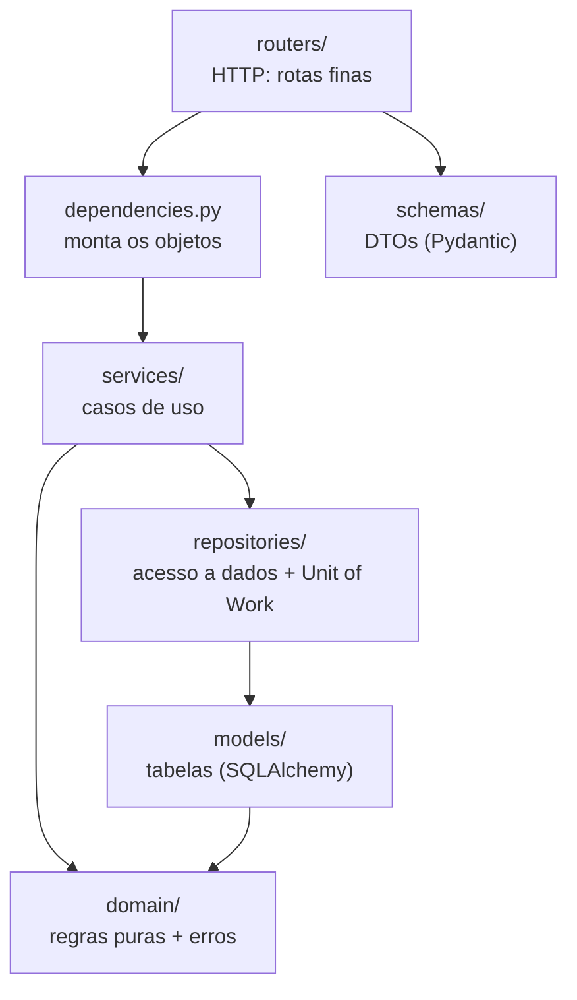

# Arquitetura do Backend

> Como o código do backend é organizado e quais padrões de projeto ele segue. As regras de negócio estão no [escopo do sistema](diagrama.md); este documento trata de **onde** cada coisa fica no código.

## Sumário

1. [Camadas](#1-camadas)
2. [Caminho de uma requisição](#2-caminho-de-uma-requisição)
3. [Padrões em uso](#3-padrões-em-uso)
4. [Padrões planejados](#4-padrões-planejados)
5. [Como adicionar uma feature](#5-como-adicionar-uma-feature)
6. [Decisões](#6-decisões)
7. [Frontend](#7-frontend)

---

## 1. Camadas

| Pasta             | Responsabilidade                                                                 | Pode importar                         |
| ----------------- | -------------------------------------------------------------------------------- | ------------------------------------- |
| `domain/`         | Regras de negócio puras e erros de domínio. Sem banco, sem HTTP, sem framework.  | Nada do projeto                       |
| `models/`         | Tabelas mapeadas pelo SQLAlchemy. São as entidades do sistema.                   | `domain/`                             |
| `repositories/`   | Consultas ao banco e o Unit of Work, que controla a transação.                   | `models/`, `domain/`                  |
| `services/`       | Casos de uso: buscam dados, aplicam regras, salvam. Não conhecem HTTP.           | `repositories/`, `models/`, `domain/` |
| `schemas/`        | Formato de entrada e saída da API (validação e o que o cliente vê).              | Só enums e constantes de `domain/` (ex.: `Role`, `CODE_LENGTH`) |
| `routers/`        | Recebem a requisição, chamam um service, devolvem a resposta.                    | `dependencies.py`, `schemas/`         |
| `dependencies.py` | Composition root: decide qual objeto cada rota recebe.                           | Tudo                                  |
| `api.py`          | Cria a aplicação, registra os routers e traduz erros de domínio em HTTP.         | Tudo                                  |

**Regra de dependência:** as setas só apontam para dentro. `domain/` não importa nada do projeto nem de framework, e `services/` nunca importa FastAPI. Isso atende ao princípio "regras isoladas do framework" da [estratégia de testes](diagrama.md#15-estratégia-de-testes).

---

## 2. Caminho de uma requisição

Exemplo: o usuário 7, logado, faz `PATCH /v1/users/7` com um e-mail que outra pessoa já usa.

1. Antes da rota rodar, `CurrentUserDep` (`dependencies.py`) valida o token Bearer e carrega o usuário logado. Sem token válido, a resposta é **401** e a rota nem roda.
2. O **router** (`routers/users.py`) recebe o corpo já validado pelo **schema** `UserUpdate` e chama `users.update(current_user, 7, ...)`.
3. O `UserService` chegou pronto via **injeção de dependência** (`dependencies.py`), com o Unit of Work e o hasher de senha.
4. O **service** pergunta à **Policy** (`can_manage_user` em `domain/permissions.py`) se quem está logado pode mexer na conta 7: só a própria conta ou um admin. Se não puder, `PermissionDenied` vira **403**. A checagem vem antes da busca, então quem não tem permissão nem descobre se a conta 7 existe.
5. O service busca o usuário pelo **repository** (`uow.users.get`), altera os campos e chama `uow.commit()`.
6. O banco recusa por causa do índice único `users_email_key`. O **Unit of Work** traduz esse erro de banco para o erro de domínio `EmailAlreadyExists`.
7. O handler registrado em `api.py` transforma `ConflictError` em **HTTP 409** com a mensagem do erro.

O service não sabe que existe HTTP, e o router não sabe que existe banco.

---

## 3. Padrões em uso

| Padrão                         | Onde                                                     | Para quê                                                                                                   |
| ------------------------------ | -------------------------------------------------------- | ---------------------------------------------------------------------------------------------------------- |
| Arquitetura em camadas         | estrutura de pastas                                      | Cada mudança fica em um lugar previsível; regras testáveis sem servidor nem banco.                          |
| Service Layer                  | `services/`                                              | Um método por caso de uso. É a única porta de entrada para alterar dados.                                   |
| Repository                     | `repositories/base.py`, `repositories/user.py`           | Concentra as consultas. Quem usa pede "usuários da página 2", não monta SQL. A listagem pública (`ItemRepository.search_public`) acrescenta um `where` por filtro que veio, e o status vem fixo do domain (RN50). |
| Unit of Work                   | `repositories/unit_of_work.py`                           | Todos os repositories de uma requisição compartilham a transação; `commit()` salva tudo ou nada.            |
| Data Mapper / Identity Map     | SQLAlchemy (`models/`)                                   | O model não salva a si mesmo; a sessão rastreia as mudanças e evita carregar o mesmo registro duas vezes.   |
| DTO                            | `schemas/`                                               | Entrada e saída separadas do model. A senha não aparece na resposta porque `UserOut` não tem o campo. A reivindicação tem um DTO por público ([§10](diagrama.md#10-privacidade)): `ClaimOut` (reivindicante) não tem nota nem motivo da rejeição (RN21); `ClaimReviewOut` (atendente) tem a nota e cada resposta ao lado da esperada (RN22), mas não o código de retirada. O item também: `ItemOut` (quem registra) e `ItemPublicOut` (a listagem pública, RN50), sem perguntas, achador, status nem a descrição crua, que dá lugar a `public_description` (RN52). |
| Injeção de dependência         | `dependencies.py`, construtores dos services             | O service recebe o que usa, em vez de criar. Nos testes dá para trocar qualquer dependência.               |
| Exceções de domínio            | `domain/errors.py`, `api.py`                             | O service lança `UserNotFound`; só o `api.py` sabe que isso vira 404.                                       |
| Tradução de erros na borda     | `CONFLICTS` em `repositories/unit_of_work.py`            | Violação de constraint conhecida vira erro de domínio; qualquer outra continua sendo bug e gera 500. Os índices únicos parciais de `claims` (uma reivindicação ativa por usuário e item, RN11; uma aprovada por item, RN13) seguram duas requisições simultâneas que o service não consegue separar. |
| Trava de linha                 | `UserRepository.lock`, `ClaimRepository.get_for_update`, `ClaimRepository.lock_pending_by_item`, `ItemRepository.get_for_update` | `SELECT ... FOR UPDATE` até o commit. Criar reivindicação trava a linha do usuário, então as contagens do banco (RN11, RN12, RN15) valem mesmo numa rajada de requisições; aprovar, rejeitar, cancelar e retirar travam a reivindicação, e a segunda operação vê o status que a primeira deixou (a segunda retirada com o mesmo código recebe "já usado"). A retirada também trava as outras pendentes do item antes de rejeitá-las (RN14), para não sobrescrever um cancelamento feito ao mesmo tempo. Receber trava o item: de dois atendentes recebendo ao mesmo tempo, o segundo vê `disponivel` e recebe 409, sem gravar uma segunda linha no histórico. Enviar e confirmar a chegada de uma transferência travam o item do mesmo jeito. |
| Registro só de inserção        | `CustodyRecord` em `models/custody.py`, `CustodyRepository` | O histórico de custódia (RN42, RN43) só ganha linhas. O repository só tem `add` e `list_by_item`, sem herdar o `Repository` base (que teria `delete`), e a relação `Item.history` não tem `delete-orphan`. Cada linha guarda o tipo, o ponto, o responsável (`actor_id`, `SET NULL` se a conta for apagada) e a hora do relógio injetável. |
| Autenticação por token (JWT)   | `services/auth.py`, `services/token.py`, `CurrentUserDep` em `dependencies.py` | `POST /v1/auth/login` devolve um token Bearer que expira em 1 hora. A rota que exige login recebe `user: CurrentUserDep`; o token é validado antes da rota rodar e o service nunca lê cabeçalho HTTP. |
| Policy (permissões)            | `domain/permissions.py`, chamada pelos services          | Cada regra é uma função pura que responde sim ou não (`can_manage_user`, `can_change_role`...); `ensure(...)` transforma o "não" em `PermissionDenied` (403). O service recebe o usuário logado (`actor`) e checa antes de agir. Nada de `if role == ...` nas rotas. RN41 é `can_operate_item(actor, item_point_id, actor_point_ids)`: o atendente só analisa e entrega reivindicações de itens dos seus pontos, e o admin opera todos. |
| Relógio injetável              | `domain/clock.py`, `ClockDep` em `dependencies.py`       | O service recebe um `Clock` e pede `clock.now()`; nenhuma regra chama `datetime.now()` direto ([§15](diagrama.md#15-estratégia-de-testes)). Em produção é o `SystemClock` (UTC); nos testes de API, a fixture `clock` troca por um `FakeClock` que só anda quando o teste manda. Hoje é usado no desbloqueio (`users.unblocked_at`, RN16), na reivindicação (`rejected_at` e `approved_at`) e no histórico de custódia (`custody_records.at`), para as datas gravadas virem do mesmo relógio que o `now` do bloqueio (RN15), do prazo de retirada (RN44) e, depois, do prazo de custódia (RN04). |
| Máquina de estados             | `TRANSITIONS` e `transition()` em `domain/claims.py` e `domain/items.py`; `Item.transition_to()` e `Claim.transition_to()` | Cada estado aponta para os destinos permitidos ([seção 5](diagrama.md#5-ciclo-de-vida-do-item), [seção 6](diagrama.md#6-reivindicação), RN01); um estado que não é chave é final. Transição fora da tabela lança `InvalidTransition` (409). No item e na reivindicação, o status só muda pelo `transition_to`, que pergunta ao domain antes de gravar (`Claim.approve`, `Claim.reject` e `Claim.pick_up` passam por ele). No item, o `transition_to(alvo, by=..., at=...)` também escreve a linha do histórico com o tipo de `EVENTS` (`domain/custody.py`, RN06); como a pergunta vem antes, uma transição recusada não deixa linha. `tests/unit/test_custody.py` confere que toda seta de `TRANSITIONS` tem um tipo. Os testes tentam todos os pares de estados com `product` (`tests/unit/test_claims.py` e `tests/unit/test_items.py`). |
| Funções puras de regra         | `domain/verification.py`, `domain/pickup.py`             | A verificação de posse ([§7](diagrama.md#7-verificação-de-posse)) normaliza as respostas, compara com tolerância a um erro de digitação e calcula a nota. Recebe só textos, então é testada sem banco em `tests/unit/test_verification.py`. O código de retirada (RN44 a RN46) é gerado com `secrets`, e a validação recebe o estado da reivindicação e a hora atual (`now`): o uso único sai da máquina de estados, porque a retirada leva a reivindicação para `CONCLUIDA`, que é final. O código digitado é conferido primeiro, com `secrets.compare_digest`, então um código errado não revela se a reivindicação já foi retirada. Testes em `tests/unit/test_pickup.py`. |

Hierarquia de erros: `DomainError` → `NotFoundError` (404), `ConflictError` (409), `UnauthorizedError` (401, com o cabeçalho `WWW-Authenticate: Bearer`), `ForbiddenError` (403) e `InvalidRequestError` (422, um corpo válido que não combina com o registro, como 2 respostas para um item com 3 perguntas). 401 quer dizer "não sei quem você é"; 403, "sei, mas você não pode". Um erro novo herda de uma delas e já sai com o status certo, sem `try/except` no router.

---

## 4. Padrões planejados

> **Ainda não implementados.** O código atual tem o cadastro de usuários, o login, as permissões sobre contas, as listas fixas (categorias, locais e cores), os pontos de coleta com o vínculo dos atendentes (RN40), o registro do item com as perguntas de verificação (RN20), a máquina de estados do item e da reivindicação (RN01), o cálculo da verificação de posse, as regras do código de retirada, a reivindicação com a análise do atendente (RN10 a RN15, RN21, RN22 e RN41), o recebimento do item com o histórico de custódia (RN02, RN06, RN42, RN43), a retirada no balcão (RN14, RN44 a RN46), a transferência entre pontos (RN05) e a listagem pública com busca, filtros e o schema público (RN50, RN52). Esta seção define onde cada regra do [escopo](diagrama.md) vai morar quando for implementada.

| Regra do escopo                                                                | Padrão                                     | Como fica no código                                                                                                                                                       |
| ------------------------------------------------------------------------------ | ------------------------------------------ | ------------------------------------------------------------------------------------------------------------------------------------------------------------------------- |
| Match ([§8](diagrama.md#8-relato-de-perda-e-match-automático))                 | Strategy                                   | Cada critério (data, local, cor, descrição) é uma regra com peso, e os filtros (categoria, data) ficam à parte. A nota é a soma. Dá para testar e ajustar cada critério isolado. |
| Prazos (RN03, RN04, RN33, RN44)                                                | Relógio injetável (já em uso, ver §3)      | O service que aplica o prazo recebe o `Clock` pelo `dependencies.py` e passa `clock.now()` para a regra em `domain/`. Os testes avançam o `FakeClock` em vez de esperar o tempo passar. |
| Notificação de match (RN30, RN31)                                              | Observer / eventos de domínio              | O service do item publica "item ficou disponível"; um handler calcula o match e notifica. Registrar item não depende de notificação. RN31 vira constraint única no par relato × item. |
| Parâmetros do sistema ([§12](diagrama.md#12-parâmetros-do-sistema))            | Objeto de configuração                     | Um objeto com os prazos e limites, injetado nos services pelo `dependencies.py`. Os testes passam valores próprios.                                                        |
| Privacidade ([§10](diagrama.md#10-privacidade))                                | Um DTO por público                         | Falta o DTO do achador (RN53), que acompanha só o estado do item. Os do público, do reivindicante e do atendente já existem (ver seção 3). |

---

## 5. Como adicionar uma feature

Exemplo: cadastro de pontos de coleta.

1. **`domain/`**: regras puras, enums e erros novos (`CollectionPointNotFound(NotFoundError)`).
2. **`models/`**: o model, importado em `models/__init__.py`.
3. **Migração**: `alembic revision --autogenerate -m "create collection points"` (ver [README](../README.md#migrações)).
4. **`repositories/`**: `CollectionPointRepository(Repository[CollectionPoint])`, um atributo novo no `UnitOfWork` e, se houver constraint única com significado de negócio, uma entrada em `CONFLICTS`.
5. **`services/`**: `CollectionPointService(uow, ...)`, com um método por caso de uso e um `commit()` no fim de cada um que altera dados.
6. **`dependencies.py`**: `get_collection_point_service` e o alias `CollectionPointServiceDep`.
7. **`schemas/`**: DTOs de entrada e saída.
8. **`routers/`**: as rotas e o `include_router` em `api.py`. Rota que exige login declara `current_user: CurrentUserDep` e o repassa ao service, que checa a permissão com uma regra de `domain/permissions.py`.
9. **Testes**: em `tests/unit/` o que estiver em `domain/` (sem banco), em `tests/integration/` o repository e as constraints, e em `tests/api/` o fluxo pelas rotas. Cite a regra no nome do teste ou num comentário (`# RN13`) para manter a rastreabilidade.

---

## 6. Decisões

- **O model do SQLAlchemy é a entidade.** Não há uma camada separada de entidades "puras" espelhando os models, o que evita duplicação. O que precisa ser puro (cálculos, máquinas de estado) fica em `domain/` e trabalha com valores simples.
- **Sem interfaces (`Protocol`) para os repositories, por enquanto.** Hoje existe uma implementação de cada. Quando algum teste precisar de um repository falso, extraia o `Protocol` nesse momento.
- **Organização por camada, não por feature.** Com 8 a 10 entidades previstas, cada pasta fica com poucos arquivos e a regra de dependência continua visível na estrutura.
- **A permissão é checada no service, não no router.** É regra de negócio: vale para qualquer porta de entrada (rota, script, tarefa agendada), e o router continua fino. As regras em si ficam em `domain/permissions.py` para serem testadas sem banco.
- **`Actor` é um `Protocol` em `domain/permissions.py`.** As regras precisam só de `id` e `role`. O `Protocol` deixa o model `User` entrar direto sem `domain/` importar `models/`, e nos testes unitários basta um objeto simples com esses dois campos.
- **Ninguém vira admin pela API.** O cadastro sempre dá o papel `usuario`, e só um admin muda papéis (`PATCH /v1/users/{id}/role`), nunca o próprio. O primeiro admin sai do `make_admin.py`, que exige acesso ao banco.
- **O bloqueio não é guardado, só o desbloqueio.** Estar bloqueado sai das rejeições, calculado por `domain/blocking.py` (RN15). O banco guarda apenas `users.unblocked_at`, a última vez que um admin desbloqueou o usuário (`POST /v1/users/{id}/unblock`, RN16); as falhas anteriores a essa data deixam de contar. Uma coluna `blocked` poderia ficar fora de sincronia com as rejeições.
- **A resposta esperada fica em texto puro, mas nunca sai na API.** Hash não aceitaria erro de digitação (§7) e o atendente não veria a resposta ao revisar (RN22). A proteção é o schema: `QuestionOut` não tem o campo `answer` (RN23). O item nasce `registrado` pelo `server_default`, e o achador vem do token, nunca do corpo.
- **A reivindicação nasce com a nota.** O service calcula a nota ao criar: abaixo de 60% ela já nasce `rejeitada` (com `rejected_at` do relógio injetável, para contar no bloqueio), e a resposta é 201 do mesmo jeito, porque a reivindicação existe e o status diz o resultado (RN21). As respostas dadas ficam em `claim_answers`, na posição da pergunta, para o atendente compará-las (RN22).
- **Reivindicação alheia é 404 para o usuário e 403 para o atendente.** Quem tenta cancelar a reivindicação de outra pessoa recebe 404, para um id não revelar quem reivindicou o quê. O atendente de outro ponto recebe 403 (RN41): ele é da equipe, e saber que a reivindicação existe em outro ponto não expõe nada.
- **Excluir a conta cancela as reivindicações ativas.** As reivindicações são apagadas junto com a conta (`ON DELETE CASCADE`), mas antes a aprovada devolve o item para `disponivel`, senão ele ficaria reservado para ninguém.
- **O recebimento é uma rota de ação, não um PATCH no status.** `POST /v1/items/{id}/receive` recebe o ponto do balcão onde o objeto foi entregue. O item passa para esse ponto antes da seta (RN02), então a linha de `recebimento` já sai com o ponto certo. A permissão é checada no ponto do balcão (RN41), não no ponto que o achador indicou. O corpo também aceita uma `description` opcional (RN51): ela é trocada depois da seta, então um recebimento recusado (409) não muda o texto, e sem ela fica a do achador.
- **A fila do recebimento mostra os itens de todos os pontos.** `GET /v1/items/registered` é só para a equipe (`can_receive_items`) e traz todos os `registrado`, dos mais antigos para os mais novos, porque qualquer atendente pode receber qualquer um deles (RN02). Quem barra o balcão errado é a RN41, no `receive`.
- **O registro é a primeira linha do histórico, escrita no `register`.** Nascer não é uma seta da máquina de estados, então o `transition_to` não a escreve; o service cria o item já com a linha de `registro`, no mesmo commit.
- **A transferência guarda só o destino, em `items.transfer_to_id`.** O resto (quem enviou, quem recebeu, quando e de onde) já está no histórico, nas linhas `transferencia_saida` e `transferencia_chegada`, então uma tabela de transferências repetiria o histórico. `POST /v1/items/{id}/transfer` é do atendente do ponto onde o item está (RN05, RN41) e só aceita item `disponivel`: um item `reservado` fica onde o dono vai buscá-lo. `POST /v1/items/{id}/arrive` é do atendente do destino. Até a chegada, `collection_point_id` continua sendo a origem; na chegada, o item passa para o destino antes da seta, e a linha de `transferencia_chegada` já sai com o ponto certo, como no recebimento. `GET /v1/items/transfers` mostra à equipe o que está saindo ou chegando nos seus pontos, com `ItemTransferOut`; o `ItemOut` do achador não tem o destino (RN53).
- **`items_transfer_to_id_check`: destino exatamente enquanto o item está `em_transferencia`, e nunca o ponto de origem.** As regras do envio (só item `disponivel`, só para outro ponto) ficam no `Item.transfer_to`, como as do recebimento no `Item.receive`; o service só busca, checa a permissão e confere se o destino existe.
- **Receber é só a primeira chegada (RN02).** O diagrama também leva `RESERVADO` e `EM_TRANSFERENCIA` para `DISPONIVEL`, mas essas setas são da reivindicação (prazo vencido ou cancelamento) e da chegada da transferência. O `Item.receive` recusa (409) qualquer item que não esteja `registrado`; antes, um item reservado "recebido" de novo voltava à prateleira com a reivindicação aprovada ainda esperando por ele.
- **Aprovar, rejeitar e retirar travam o item, depois da reivindicação.** `_find_for_staff` trava a reivindicação e em seguida o item. Assim, um envio, uma chegada ou um recebimento ao mesmo tempo esperam, e a RN41 e a RN13 leem o ponto e o status atuais. Envio, chegada e recebimento só travam o item, então a ordem reivindicação → item não gera deadlock.
- **As reivindicações pendentes seguem o item.** O ponto da reivindicação é o do item (`Claim.collection_point_id`), então nada muda nas reivindicações: durante a transferência ninguém aprova (o item não está `disponivel`, RN13), mas a origem ainda pode rejeitar, porque analisar as respostas não depende do objeto. Na chegada, elas passam para a fila de análise do destino, e o reivindicante vê o novo ponto (RN53). O item a caminho continua aceitando reivindicações (escopo §5).
- **Não há como cancelar uma transferência.** O diagrama só tem a seta da chegada. Um envio para o ponto errado chega lá e volta com outro envio; um destino sem atendentes depende do admin, que opera todos os pontos.
- **`liberacao` é um tipo novo do histórico.** A seta `RESERVADO → DISPONIVEL` (prazo de retirada vencido ou reivindicação aprovada cancelada) não tinha nome na RN42. É uma decisão provisória do grupo, registrada também no [escopo](diagrama.md#histórico-de-custódia).
- **A retirada é feita pela reivindicação, não pela busca do código.** O atendente vê a fila do balcão (`GET /v1/claims/approved`, as aprovadas dos seus pontos), escolhe quem chegou e envia `POST /v1/claims/{id}/pickup` com o ponto do balcão, o código digitado e o "documento com foto conferido". Buscar pelo código exigiria um código único entre todas as reivindicações e tornaria possível testar códigos a esmo. Pelo id, o código só serve como prova de que a pessoa no balcão é dona da conta, e um código errado é 422 (`InvalidPickupCode`), não 404: a reivindicação existe, o código é que não combina com ela. A permissão (RN41) é checada no ponto do item, como na análise, e o ponto do balcão precisa ser esse mesmo ponto (RN45, 409). Uma aprovada com o prazo vencido continua na fila até a tarefa agendada expirá-la (Parte 3); a fila traz o `pickup_deadline`, e a retirada já recusa o código vencido.
- **O atendente vê o nome do reivindicante só na fila de retirada.** Sem o nome, não há com o que comparar o documento com foto (RN46). A análise (`ClaimReviewOut`) continua só com o id.
- **Retirar rejeita as outras pendentes do item no mesmo commit.** Elas passam a `rejeitada` com o motivo `item_devolvido` (RN14), que `domain/blocking.py` não conta como falha (RN15).
- **Só a equipe vê o histórico.** `GET /v1/items/{id}/history` é para atendente e admin (`can_view_custody`); o achador e o reivindicante acompanham só o status (RN53). Qualquer atendente vê, de qualquer ponto: ler o histórico não opera o item.
- **Num documento, a listagem mostra um texto fixo, e a busca pula os documentos.** A RN52 pedia o tipo e o nome mascarado, mas a descrição é livre e não dá para saber qual parte é o nome. A listagem mostra "Documento de identificação" (`public_text` em `domain/items.py`, lida pela propriedade `Item.public_description`), e o nome vira uma pergunta de verificação. A busca por texto ignora a categoria Documentos: achar o item por "Silva" confirmaria o nome que o cartão esconde. O documento continua achável pelo filtro de categoria. É uma decisão provisória do grupo, registrada também na [RN52](diagrama.md#10-privacidade).
- **A listagem pública é aberta e não confere os ids dos filtros.** `GET /v1/items` não tem `CurrentUserDep`. Um `category_id` que não existe só devolve a lista vazia, sem 404: filtrar não aponta para nada no banco, ao contrário do registro.
- **O commit é do service, não da requisição.** A resposta só sai depois que os dados foram salvos, e um caso de uso que mexe em várias tabelas (aprovar reivindicação: item, reivindicação e histórico) salva tudo numa transação só.

---

## 7. Frontend

O frontend (`frontend/`) é uma SPA em React com TypeScript, criada com o Vite. Ele só conversa com a API por HTTP.

| Onde                | O que tem                                                                                                                                                                                   |
| ------------------- | ------------------------------------------------------------------------------------------------------------------------------------------------------------------------------------------- |
| `src/api/client.ts` | O único lugar que chama a API: junta `VITE_API_URL` com o caminho, envia o token no `Authorization: Bearer` e transforma erro em `ApiError` (o `detail` é uma lista no 422 e um texto nos demais). `post(body)` monta o pedido das rotas de ação. |
| `src/api/types.ts`  | Os tipos que espelham os schemas da API (`User`, `Token`, `Claim`, `ClaimReview`, `ClaimPickup`, `ItemTransfer`, `PublicItem`, `ItemCreate`, `RegisteredItem`, `ReceiveIn`...). Mudou um schema, atualize aqui. Cada tipo da reivindicação espelha o DTO do seu público (§3): o do reivindicante não tem nota, o do balcão não tem código. `PublicItem` espelha o `ItemPublicOut` (sem perguntas, achador nem status, RN50), e `Option` serve às três listas fixas. |
| `src/api/claims.ts`, `src/api/items.ts` | Uma função por rota (`claimsApi.approve(id)`, `itemsApi.listPublic(params)`, `itemsApi.register(item)`, `receiptsApi.receive(id, dados)`, `transfersApi.send(id, destino)`...), todas por cima do `api()`; as telas não montam URL.                                    |
| `src/api/catalog.ts` | `useCatalog()` carrega categorias, locais e cores e dá o `nameOf(id)` de cada lista, no molde do `usePoints()`: a API responde só com os ids. |
| `src/api/hooks.ts`  | `useLoad(fn)` carrega ao abrir a tela e devolve `data`, `error`, `loading` e `reload()`; `usePoints()` dá o nome de cada ponto de coleta, já que a API responde só com o id; `errorText` mostra a mensagem da API, que já vem em português. |
| `src/auth/`         | `AuthProvider` e `useAuth()`, com o usuário logado vindo do `/me`; `RequireAuth` protege as rotas, e `RequireRole` as que são de um papel (`STAFF` em `roles.ts`: atendente e admin). |
| `src/components/`   | `Header` (o topo de todas as telas, com os links de cada papel e o Entrar/Sair), `Page` (moldura com título e conteúdo) e `LoadState`. As cores do site são variáveis em `src/index.css`; `page.css` dá o estilo dos formulários, botões, cartões e tabelas.                                                         |
| `src/pages/`        | Uma tela por rota, ligadas em `App.tsx`. O mural: `HomePage` (`/`, aberta, com busca e filtros). O registro: `RegisterItemPage` (`/itens/novo`, com login). O recebimento: `ReceiveItemsPage` (`/atendimento/recebimento`, só para a equipe). Da reivindicação: `ClaimItemPage` (`/itens/:id/reivindicar`), `MyClaimsPage` (`/reivindicacoes`), `ReviewClaimsPage`, `PickupPage` e `TransfersPage` (em `/atendimento/...`). |

- **O token fica no `localStorage`.** Aguenta o F5 e não muda o backend. O risco (XSS) cai porque o React escapa o texto e o token vale 1 hora. Um 401 num pedido com token apaga o token e desloga.
- **A tela guia, a API decide.** O `RequireAuth` e o `RequireRole` só escondem telas; quem barra de verdade é o `CurrentUserDep` e as regras de `domain/permissions.py`. Por isso a tela de transferências mostra "Confirmar chegada" só nos itens que vão para os pontos do atendente (`GET /v1/collection-points/mine`), mas é a API que recusa os outros (RN41).
- **As perguntas só aparecem para quem vai reivindicar.** A listagem pública não mostra as perguntas (RN50); a tela de reivindicar busca `GET /v1/claims/items/{id}/questions`, que só responde a um usuário logado e não bloqueado (RN15), num item que aceita reivindicação, que não é dele (RN10) e que ele ainda não reivindicou (RN11). Mesmo assim, qualquer conta lê as perguntas de qualquer item disponível; o projeto ainda não tem limite de requisições. O resultado mostra só "em análise" ou "rejeitada" (RN21).
- **O mural é a página inicial e não pede login.** Qualquer visitante vê os cartões (RN50); o "Reivindicar" leva ao login pelo `RequireRole`, e a equipe não o vê. Os filtros entram no endereço pelo `URLSearchParams`, só os preenchidos. O `load` fica num `useCallback` com os filtros como dependência, então o `useLoad` pede de novo a cada mudança e descarta a resposta que chega atrasada. A data vem como `ano-mês-dia` e é só invertida para `dia/mês/ano`: `new Date()` leria meia-noite UTC e mostraria o dia anterior.
- **O registro confere na tela o que a API confere de novo.** Campos `required`, até 500 caracteres e de 2 a 5 perguntas, com os botões de pôr e tirar travados nos limites (RN20); a API valida tudo outra vez (422). Ao lado da descrição, o aviso da RN51: o que identifica o dono vira pergunta. O item nasce `registrado` e só entra no mural depois do recebimento, por isso a tela de sucesso manda levar o objeto ao balcão.
- **O recebimento começa pelo balcão, mas a fila não depende dele.** O atendente escolhe o ponto em que está (`GET /v1/collection-points/mine`) e vê todos os itens registrados, com o ponto que o achador indicou (RN02). A descrição já vem preenchida e pode ser editada, com o aviso de tirar o que só o dono saberia (RN51). Confirmado, o item sai da fila e entra no mural.
- **A retirada começa pelo balcão.** O atendente escolhe o ponto em que está, vê quem aguarda retirada ali (o código só vale onde o item está, RN45), digita o código que a pessoa mostra e marca o documento conferido, com o nome dela na tela (RN46).
- **Sair leva ao mural.** Se a pessoa ficasse numa tela protegida, o `RequireAuth` guardaria aquela tela para o próximo login, e quem entrasse com outro papel cairia em "Acesso negado".
- **CORS no `api.py`.** As origens aceitas vêm de `CORS_ORIGINS`; em produção, ela precisa ter o endereço do site.

### Referências

- Harry Percival e Bob Gregory, *Architecture Patterns with Python* ([cosmicpython.com](https://www.cosmicpython.com/)): Repository, Unit of Work, Service Layer e eventos de domínio em Python.
- Martin Fowler, *Patterns of Enterprise Application Architecture*: Data Mapper, Identity Map e Unit of Work.
